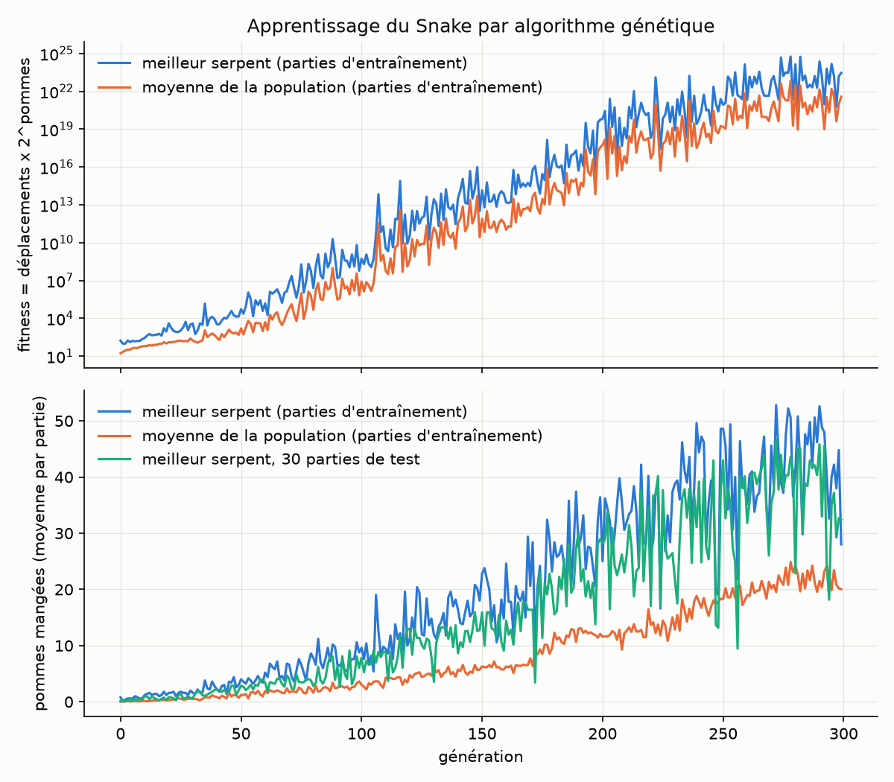

# TIPE

My TIPE from prépa (the personal research project French students present for the engineering school exams). A small neural network plays Snake, and instead of training it with gradients I evolve a population of networks with a genetic algorithm. The slides I presented are in `TIPE.pdf`. Code comments and program output are in French.

## How it works

The game is a 20x20 grid with one apple at a time. The snake starts with 3 cells and dies if it hits a wall or itself, or if it makes 100 moves without eating. Without that last rule some snakes just turn in circles forever.

The network gets 53 inputs: the 7x7 window around the head (0 empty, 1 apple, -1 wall or body) and 4 values that say if the apple is left, right, up or down. Then two hidden layers of 8 neurons with tanh, and 4 outputs, one per direction. The snake goes where the output is the highest. A genome is just the 540 weights of the network.

Each generation the 200 snakes play the same 5 games, and the fitness is `moves * 2^apples` averaged over the 5 games. The best 25% go to the next generation unchanged. The rest is filled with children of two of them (uniform crossover then mutation), one mutated copy of each of them and 10% random networks. A mutation changes each weight with probability 0.5, by uniform(-1, 1) * 0.2. It runs for 300 generations.

The best snake of the last generation was only ranked on 5 games, so it's often a lucky one. At the end I replay the top 10 on 100 new games and save the one that eats the most.

Compared to the version in the slides I added the 4 apple direction inputs, went from 30 to 200 snakes and from 1 to 5 games per snake, and the 100 move limit now counts moves without eating instead of total moves.

## Results

Default run (`python main.py train`, seed 0), about 8 min on 14 cores.



Blue and orange are the best snake and the population mean on the training games. Green is the best snake of each generation replayed on 30 fixed test games that are never used for selection. Green is usually under blue (36.6 vs 41.6 apples over the last 50 generations), so the best snake looks better on its training games than it really is.

| | apples per game |
|---|---:|
| random moves (no U-turn) | 0.08 |
| generation 0, population mean | 0.03 |
| generation 299, population mean | 20.1 |
| generation 299, best snake on its 5 training games | 28.0 |
| saved snake | 38.1 (median 44.5, max 67) |

Random moves and the saved snake are on the same 100 games (`play --games 100 --seed 10000`). The final pick helps: on its 100 games the first of the last generation eats 28.2 apples per game and the saved snake 38.5. Out of the 100 games, 84 end in a wall or the body and 16 by starvation. Once it gets long the snake mostly traps itself, it only sees 7x7 cells and the direction of the apple.

With only the 7x7 window, like in the slides (the current code always adds the 4 direction inputs, so you can't rerun this one as is), the best snake ate 0.12 apples per game after 150 generations, about the same as random. It only sees the apple when it's 3 cells away or less, and evolution got stuck on snakes that circle until they starve. With the apple direction inputs and the same settings it gets 12.3 after 150 generations.

The seed matters a lot too. At 150 generations I got between 7 and 16 apples per game depending on the seed.

## Usage

```bash
pip install -r requirements.txt
python main.py train   # results/best.npz and results/history.json
python main.py play    # watch the saved snake in a pygame window
python main.py plot    # results/apprentissage.png
```

`results/` is not in the repo, so `play` and `plot` need a `train` first. `python main.py play --games 100 --seed 10000 --no-display` only prints the scores, and `--random` gives the random baseline on the same games. All the training settings are flags, see `python main.py train --help`. Tests run with `pytest`.
